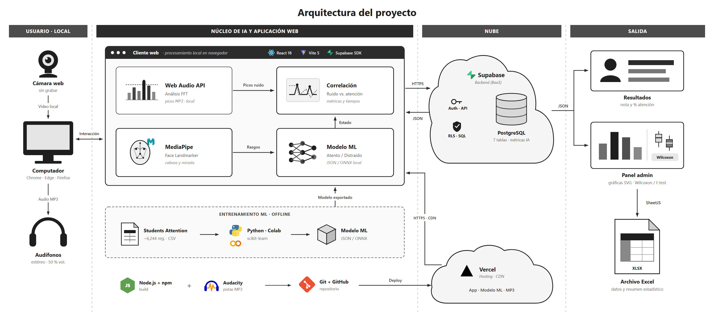

# Evaluación de la contaminación acústica sobre la atención y el rendimiento académico

**Universidad de las Fuerzas Armadas ESPE**  
**Autores:** Fernando Camatón-Realpes · Andrés Pozo-García  
**Motor de base de datos:** PostgreSQL (Supabase)

## Gestión Ágil del Proyecto (Scrum)

- **Tablero Scrum (GitHub Project):** [Planificación Scrum — Contaminación Acústica](https://github.com/users/andrespozo237-coder/projects/3)
- **Hitos de Revisión (Milestones):** [Ver los 4 Hitos de Revisión](https://github.com/andrespozo237-coder/ContaminacionAcusticaProyecto/milestones)
- **Product & Sprint Backlog (Issues):** [Ver las 20 Actividades (ACT-01 a ACT-20)](https://github.com/andrespozo237-coder/ContaminacionAcusticaProyecto/issues)

## Arquitectura del Proyecto

- **Diagrama de arquitectura:** [`docs/arquitectura.png`](docs/arquitectura.png) · versión vectorial [`docs/arquitectura.svg`](docs/arquitectura.svg)

---

## Avance · Sprint 1 (Hito 1: Base de datos)

Este repositorio contiene los entregables correspondientes al **Sprint 1** del desarrollo del aplicativo experimental (comprensión lectora bajo dos escenarios sonoros: ruido urbano y sonido de calma):

- **Diagrama entidad-relación:** [`docs/Modelo_Fisico.png`](docs/Modelo_Fisico.png)
- **Diccionario de datos:** [`docs/diccionario-datos-sprint1.csv`](docs/diccionario-datos-sprint1.csv)
- **Script SQL (PostgreSQL / Supabase):** [`supabase/sprint1_base_datos.sql`](supabase/sprint1_base_datos.sql)

## Estructura de la base de datos (7 tablas)

- `perfiles`: datos académicos del estudiante (`nombre`, `carrera`, `semestre`), vinculados 1:1 con `auth.users`.
- `sesiones`: registro de cada intento de prueba (`tipo_audifono`, `etapa`, columna generada `completada`), limitado a una sesión abierta por usuario.
- `escenarios`: los dos escenarios sonoros de la sesión (`ruido` y `calma`), posición, texto asignado, tiempo de lectura en ms y cambios de pestaña.
- `respuestas`: opción elegida (`0`–`3`), indicador `es_correcta` y tiempo de respuesta en ms por pregunta (`orden` `1`–`10`).
- `textos`: los dos textos equivalentes de lectura (*La isla de Kervalen* con 332 palabras y *El valle de Tarmiza* con 334 palabras).
- `preguntas`: 10 preguntas de opción múltiple por texto (20 en total, opciones en `jsonb`).
- `respuestas_correctas`: índice de la opción correcta (`0`–`3`) de cada pregunta en tabla separada.

## Despliegue del Sprint 1 en Supabase

1. Abrir **SQL Editor → New query** en el proyecto de Supabase.
2. Pegar el contenido completo de [`supabase/sprint1_base_datos.sql`](supabase/sprint1_base_datos.sql) y pulsar **Run**.
3. Ejecutar las consultas de verificación incluidas al final del script para comprobar los 2 textos, las 20 preguntas y sus 20 respuestas correctas.

---

## Avance · Sprint 2 (Hito 2: Backend en Supabase y audio)

- **Autenticación, seguridad RLS, rol administrador y contrabalanceo (`ACT-05`, `ACT-06`, `ACT-08`):** [`supabase/sprint2_backend.sql`](supabase/sprint2_backend.sql)
  - Enlace automático de cuentas registradas en Supabase Auth (`auth.users`) con `public.perfiles` y sincronización de rol en el JWT.
  - Políticas **RLS** activas en las 7 tablas (`estudiante`: lectura/escritura solo sobre datos propios; `admin`: solo lectura sobre resultados; `respuestas_correctas`: bloqueada desde el navegador).
  - Secuencia `contrabalanceo_seq`, función RPC `crear_sesion(p_audifono)` con asignación equilibrada en 4 combinaciones y trigger `validar_etapa()` para avance secuencial.
- **Calificación en servidor (`ACT-09`):** [`supabase/sprint2_act09_calificacion.sql`](supabase/sprint2_act09_calificacion.sql)
- **Pistas de audio y documentación (`ACT-07`, `ACT-09`):** [`docs/fuentes-audio-sprint2.md`](docs/fuentes-audio-sprint2.md), [`public/audio/ruido.mp3`](public/audio/ruido.mp3) y [`public/audio/calma.mp3`](public/audio/calma.mp3)
