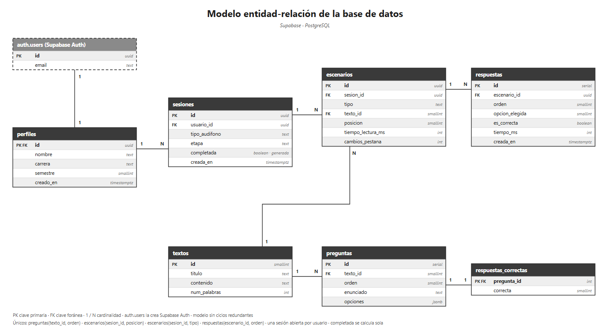

# Evaluación de la contaminación acústica sobre la atención y el rendimiento académico

**Universidad de las Fuerzas Armadas ESPE**  
**Autores:** Fernando Camatón-Realpes · Andrés Pozo-García  
**Motor de base de datos:** PostgreSQL (Supabase)

---

## Avance · Sprint 1 (Hito 1: Base de datos)

Este repositorio contiene los entregables correspondientes al **Sprint 1** del desarrollo del aplicativo experimental (comprensión lectora bajo dos escenarios sonoros: ruido urbano y sonido de calma):

- **Diagrama entidad-relación:** [`docs/modelo-er.png`](docs/modelo-er.png) · [`docs/modelo-er.svg`](docs/modelo-er.svg)
- **Diccionario de datos:** [`docs/diccionario-datos-sprint1.csv`](docs/diccionario-datos-sprint1.csv)
- **Script SQL (PostgreSQL / Supabase):** [`supabase/sprint1_base_datos.sql`](supabase/sprint1_base_datos.sql)

## Estructura de la base de datos (7 tablas)

- `perfiles`: datos académicos del estudiante (`nombre`, `carrera`, `semestre`), vinculados 1:1 con `auth.users`.
- `sesiones`: registro de cada intento de prueba (`tipo_audifono`, `etapa`, columna generada `completada`), limitado a una sesión abierta por usuario.
- `escenarios`: los dos escenarios sonoros de la sesión (`ruido` y `calma`), posición, texto asignado, tiempo de lectura en ms y cambios de pestaña.
- `respuestas`: opción elegida (`0`–`3`), indicador `es_correcta` y tiempo de respuesta en ms por pregunta (`orden` `1`–`10`).
- `textos`: los dos textos equivalentes de lectura (*La isla de Kervalen* con 332 palabras y *El valle de Tarmiza* con 334 palabras).
- `preguntas`: 10 preguntas de opción múltiple por texto (20 en total, opciones en `jsonb`).
- `respuestas_correctas`: índice de la opción correcta (`0`–`3`) de cada pregunta en tabla separada.

## Despliegue del Sprint 1 en Supabase

1. Abrir **SQL Editor → New query** en el proyecto de Supabase.
2. Pegar el contenido completo de [`supabase/sprint1_base_datos.sql`](supabase/sprint1_base_datos.sql) y pulsar **Run**.
3. Ejecutar las consultas de verificación incluidas al final del script para comprobar los 2 textos, las 20 preguntas y sus 20 respuestas correctas.
